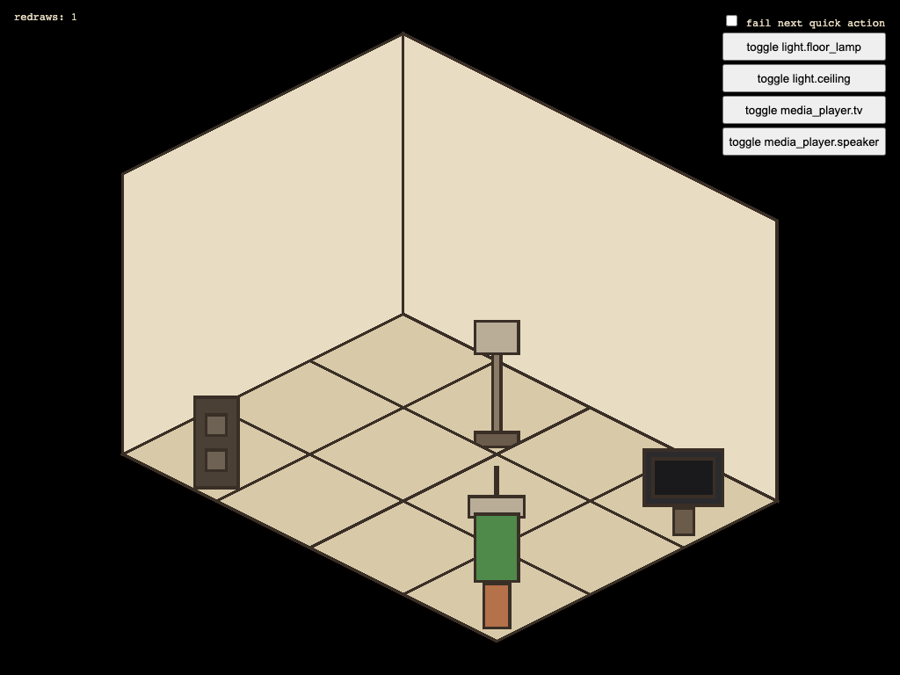

# IsoHome

Touch your house to control it: an isometric pixel-art view of a room, with real Home Assistant
devices placed in it, built for wall tablets.



*Screenshot of the playground in mock mode with placeholder sprites. An animated GIF is still to
come.*

## Status

Proof of concept: one room, imported from a Magicplan export, with tap (open the device), long-press
(one-touch action), pan, integer-step zoom and double-tap recenter. Not published yet; see
[docs/ROADMAP.md](docs/ROADMAP.md).

## Try it

```sh
pnpm install
pnpm --filter @iso-home/playground dev                 # mock mode, no Home Assistant needed
pnpm --filter @iso-home/playground dev --mode live     # real Home Assistant
```

Live mode reads `VITE_HA_URL` and `VITE_HA_TOKEN` from `apps/playground/.env.local` (copy
`.env.example`, never commit it) and uses the entity ids in `apps/playground/src/devices.ts`.

## Home Assistant card (HACS)

The card is not published to HACS yet. To use a local build:

1. `pnpm --filter @iso-home/ha-card build` produces `packages/ha-card/dist/iso-home-card.js`
   (one file, under 300 KB gzipped).
2. Once the repo is released, add it in HACS as a custom repository (category: Dashboard).
   Until then, copy the file to `<config>/www/iso-home/` and add `/local/iso-home/iso-home-card.js`
   as a Lovelace resource (type: module).
3. Serve your home model and packs under `/local/iso-home/` and configure the card:

```yaml
type: custom:iso-home-card
homeModelPath: /local/iso-home/home-model.json
packPaths:
  - /local/iso-home/packs/floor-lamp/manifest.json
```

Tap opens Home Assistant's own more-info dialog; long-press runs the pack's quick action.
Locks, alarms, valves and garage/door/gate covers can never be actuated by long-press.

## Contributing

Packs are data only (a folder with a manifest and sprites). See [CONTRIBUTING.md](CONTRIBUTING.md),
[docs/STYLE_GUIDE.md](docs/STYLE_GUIDE.md) and [docs/ASSET_PROMPTING.md](docs/ASSET_PROMPTING.md).
